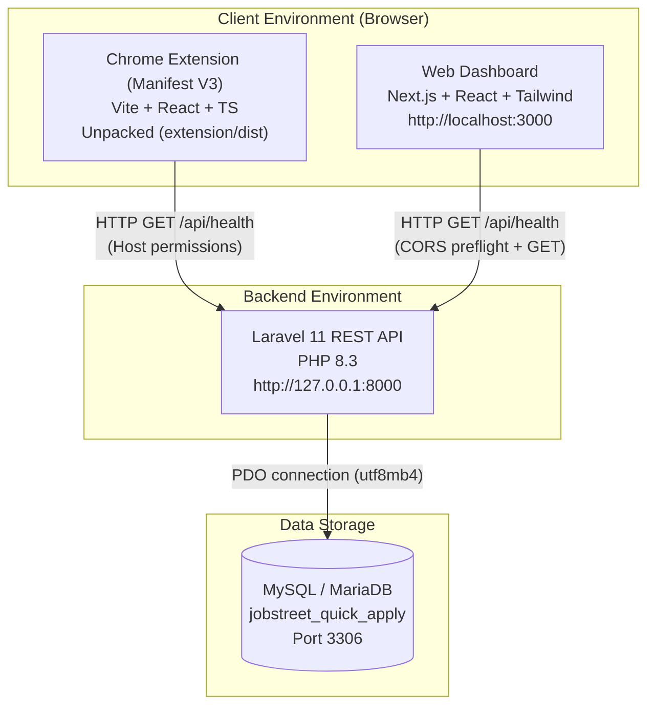

# System Architecture & Application Boundaries

This document defines the architectural boundaries, communication models, security practices, and network topology for the **JobStreet Quick Apply Automation** system.

---

## 1. High-Level Architecture Overview



---

## 2. Application Boundaries & Responsibilities

### A. Chrome Extension (`extension/`)
- **Technology Stack:** Chrome Extension Manifest V3, React 18, TypeScript, Vite.
- **Entry Points:**
  - `popup/`: UI popup that allows the user to monitor connectivity, configure automation rules, and trigger actions.
  - `background/`: Persistent service worker handling background messages and orchestration.
  - `content/`: Content scripts injected strictly into JobStreet pages (`https://www.jobstreet.com.ph/*`, `https://*.jobstreet.com/*`).
- **Security Boundaries:**
  - Minimum necessary permissions (`storage` only; no full browser history or invasive permissions).
  - Explicit `host_permissions` for the local Laravel API (`http://127.0.0.1:8000/*`).
  - No database credentials or private API keys stored in client bundles.

### B. Web Dashboard (`dashboard/`)
- **Technology Stack:** Next.js (App Router), React 19, TypeScript, Tailwind CSS.
- **Responsibilities:**
  - Administrative console to manage resumes, matched job listings, historical logs, and scoring weights (future phases).
  - In Phase 1, acts as the primary health and connectivity monitor for the backend.
- **Security Boundaries:**
  - Strict separation of public environment variables (`NEXT_PUBLIC_API_BASE_URL`) from private server variables.
  - No database credentials exposed to client-side components.

### C. Backend API (`backend/`)
- **Technology Stack:** Laravel 11.x, PHP 8.3, MySQL Driver.
- **Responsibilities:**
  - Central REST API serving both the Chrome Extension and Dashboard.
  - Input validation, business logic, health checks, and database migrations.
  - Consistent JSON response structures:
    ```json
    {
      "status": "ok",
      "service": "jobstreet-quick-apply-api"
    }
    ```
- **Security Boundaries:**
  - Safe error handling: no stack traces or credentials returned in production/public responses.
  - Dedicated database health checks that verify PDO connection without disclosing hostnames or user passwords.

---

## 3. Network Topology & Development Ports

| Component | Protocol | Host / Origin | Port | Access Rules |
| :--- | :--- | :--- | :--- | :--- |
| **Laravel API** | HTTP | `http://127.0.0.1` | `8000` | Accepts requests from `localhost:3000` and Chrome Extension |
| **Next.js Dashboard** | HTTP | `http://localhost` | `3000` | Browser front-end |
| **Chrome Extension** | chrome-extension:// | N/A | N/A | Injected into JobStreet domains & popup |
| **MySQL / MariaDB** | MySQL Protocol | `127.0.0.1` | `3306` | Accessible only to backend local process |

---

## 4. CORS and Permission Matrix

- **Laravel CORS Configuration (`backend/config/cors.php`):**
  - Routes protected: `api/*`, `sanctum/csrf-cookie`
  - Allowed Origins: `*` (or explicit `http://localhost:3000` and `chrome-extension://*`)
  - Allowed Methods: `GET, POST, PUT, PATCH, DELETE, OPTIONS`
  - Allowed Headers: `*`
- **Chrome Extension Manifest V3 Permissions (`extension/public/manifest.json`):**
  - `host_permissions`: `["http://127.0.0.1:8000/*", "http://localhost:8000/*"]`
  - `permissions`: `["storage"]`

---

## 5. Environment Variable Ownership

| Variable | Scope | Location | Sensitivity |
| :--- | :--- | :--- | :--- |
| `DB_PASSWORD`, `DB_USERNAME` | Backend only | `backend/.env` | Secret (ignored in Git) |
| `APP_KEY` | Backend only | `backend/.env` | Secret (ignored in Git) |
| `NEXT_PUBLIC_API_BASE_URL` | Dashboard (Browser & Server) | `dashboard/.env.local` | Public URL |
| `INTERNAL_API_BASE_URL` | Dashboard (Server-only) | `dashboard/.env.local` | Internal URL |
| `VITE_API_BASE_URL` | Extension build | `extension/.env` | Public URL |
