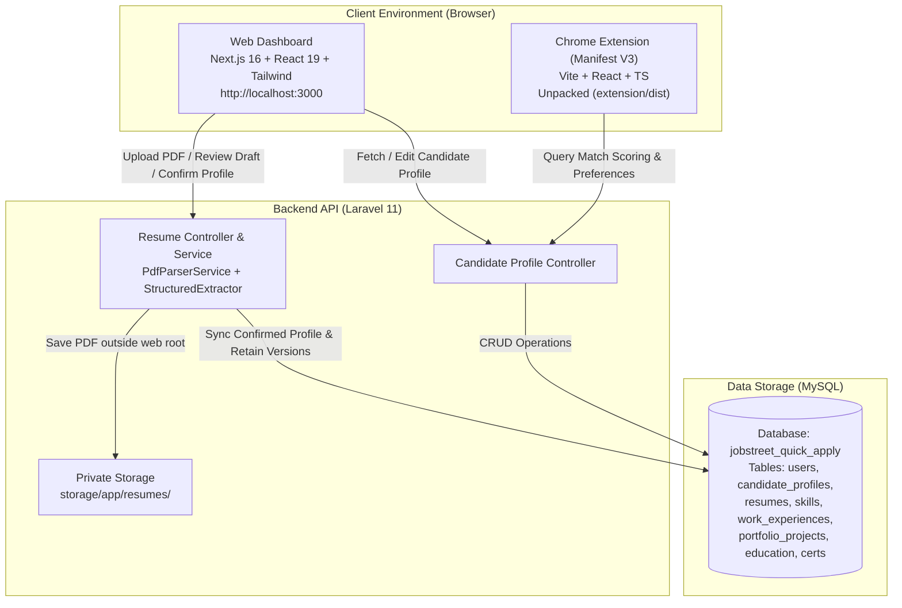
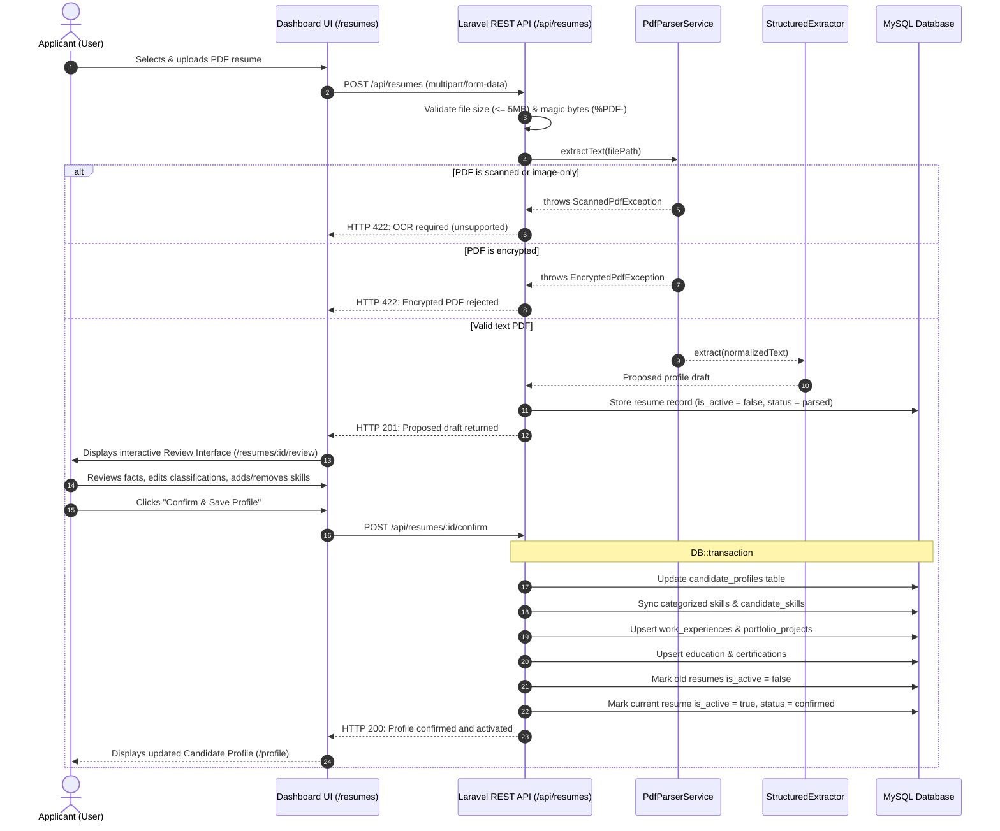
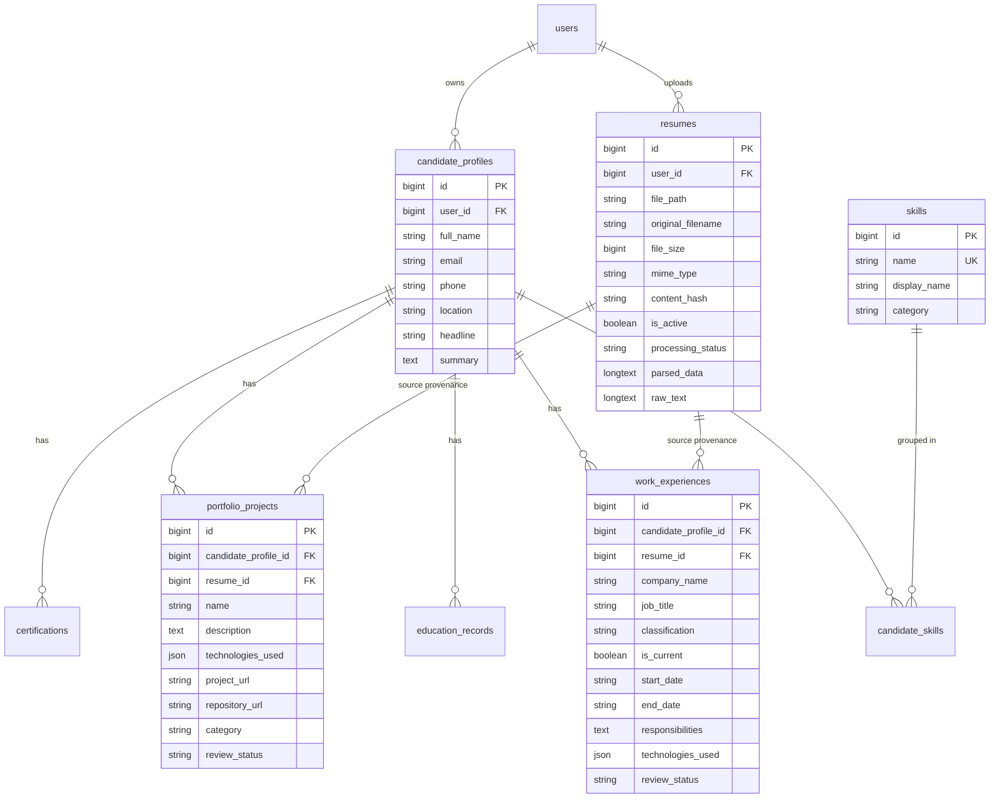
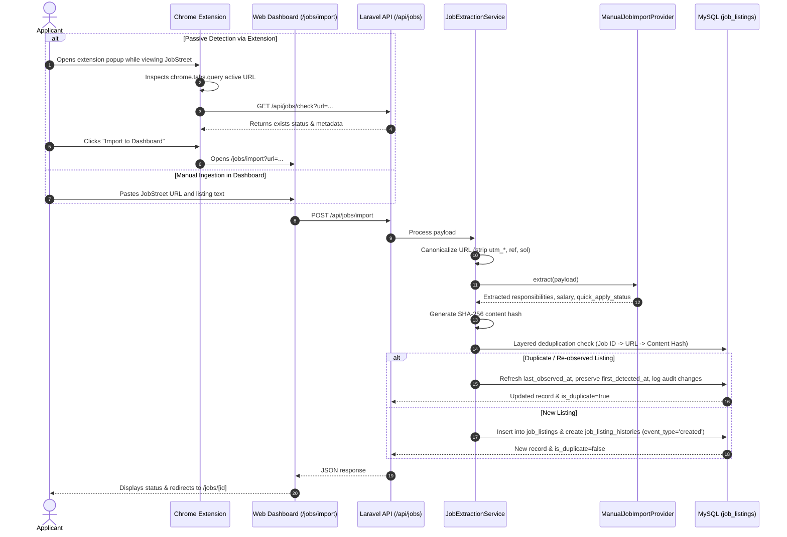
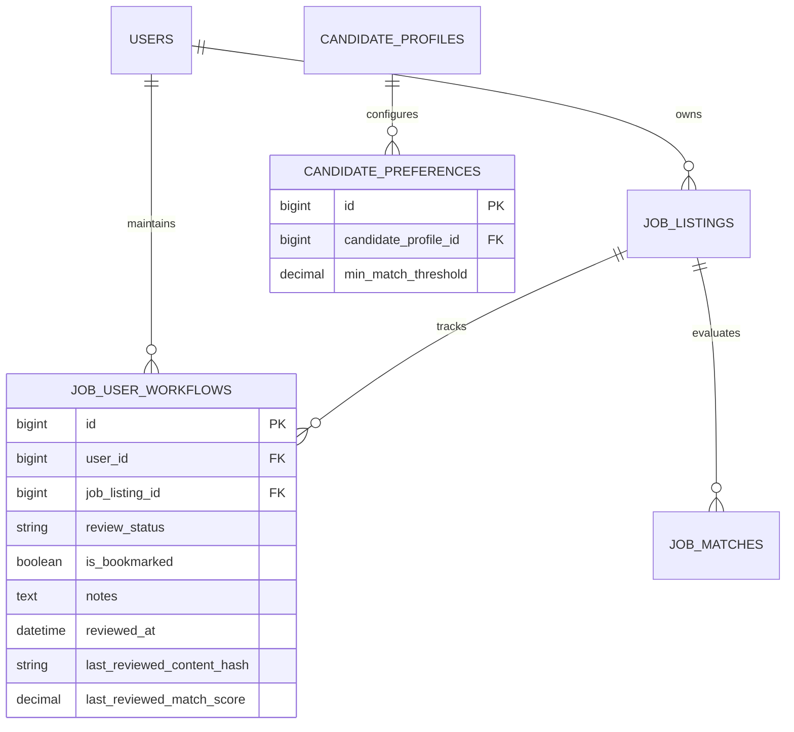

# System Architecture & Application Boundaries

This document defines the architectural boundaries, communication models, security practices, and network topology for the **JobStreet Quick Apply Automation** system.

---

## 1. High-Level Architecture Overview

---

## 2. Resume Ingestion & Review Workflow (Phase 2)

---

## 3. Candidate Profile Data Model (Normalized Schema)

---

## 4. Key Security & Privacy Safeguards

1. **Storage Isolation:** Uploaded resumes are placed in `storage/app/resumes/{user_id}/{sha256}.pdf` outside the public web root. Direct HTTP access to raw files is blocked.
2. **Strict Validation:** File extensions, MIME types, and binary file signatures (`%PDF-`) are checked on every upload.
3. **No External AI Leakage:** Parsing is performed completely locally using deterministic PHP lexicons and regular expressions. No candidate resumes or personal data are transmitted to external AI APIs.
4. **Application History Preservation:** Replacing an active resume does not delete prior resume records. Historical resumes retain their processing status and provenance foreign keys.
5. **Multi-Record Atomicity:** The confirmation action wraps profile updates, skill syncing, experience persistence, and resume status toggling in a `DB::transaction`. If any operation fails, the transaction rolls back cleanly without data corruption.

---

## 3. Job Listing Detection & Ingestion Architecture (Phase 3)

### Legal & Platform Compliance Framework
- JobStreet (SEEK Group) Terms of Use prohibit automated screen scraping and anti-bot evasion.
- No public unauthenticated JobStreet search or extraction API is made available.
- **Adopted Architecture:** Passive URL Detection via Chrome Extension + User-Initiated Assisted Ingestion.
- Background content scripts do NOT scrape DOM elements or inject bypass automation.
- Pluggable `JobExtractionProviderInterface` is utilized, enabling instant plug-in of official partner APIs (e.g. SEEK Partner API) should institutional API keys be provisioned in the future.

### Job Ingestion Sequence

### Layered Deduplication Strategy
1. **Tier 1 (Source Job ID):** Matches `[user_id, source_platform, source_job_id]`.
2. **Tier 2 (Canonical URL):** Matches `[user_id, canonical_url]`, stripping tracking parameters (`utm_source`, `ref`, `sol`, `tracking`, etc.).
3. **Tier 3 (Content Hash):** Computes `sha256(lowercase(title | company | location | description_prefix))` to prevent duplicate entries when URLs differ or are omitted.

---

## 4. Hybrid Matching Engine Architecture (Phase 4)

### Component Breakdown
1. **Component A: Deterministic Engine (Authoritative Source of Truth)**
   - Computes reproducible baseline score ($0.00 - 100.00$) independently of any AI service.
   - Factors:
     - **Technical Skills (40%):** Evaluates required (75% subweight) vs. preferred (25% subweight) skills. Grants 1.0 for exact/alias matches, 0.5 for documented related technologies (e.g. React $\rightarrow$ Next.js, MySQL $\rightarrow$ MariaDB), 0.0 for unmatched.
     - **Experience & Seniority (25%):** Calculates strictly verified professional employment duration in months. Personal and academic projects are strictly excluded from professional duration. Compares tenure with target seniority (`intern`, `junior`, `mid`, `senior`, `lead`).
     - **Job Responsibilities (15%):** Maps job duties to demonstrated proof in candidate employment (1.0 credit) or portfolio projects (0.8 credit).
     - **Work Arrangement & Type (10%):** Matches candidate editable arrangements (Remote, Hybrid, On-site) and employment types.
     - **Salary & Compensation (10%):** Compares candidate minimum and preferred salary with job maximum. Undisclosed salary is assigned neutral score (60%) without penalizing the candidate.

2. **Component B: Semantic Analysis Adapter**
   - Implements `SemanticAnalysisProviderInterface`.
   - Default: `LocalDeterministicSemanticProvider` (100% offline, zero network data egress, privacy-safe).
   - Corroborates domain competencies and transferable skills against verified candidate evidence.

3. **Component C: Eligibility & Disqualifier Evaluation**
   - Evaluated separately from numerical score.
   - Checks mandatory certifications, minimum professional tenure, work authorization, and hard disqualifiers (e.g. strictly remote-only vs. on-site).
   - Statuses: `eligible`, `disqualified`, `requires_review`.

---

## 5. Job Discovery Dashboard & Application Review Queue (Phase 5)

### Strict Separation of Architectural Concepts
To prevent false-positive applications or unvetted automation, the platform enforces strict orthogonality among four distinct states:
1. **Match Fit Score (0.00 – 100.00%):** Statistical alignment across technical skills, experience tenure, responsibilities, work arrangement, and salary fit.
2. **Eligibility Status (`eligible`, `disqualified`, `requires_review`):** Independent legal and mandatory constraint verification. A 95% match fit **never** overrides a `disqualified` or `requires_review` status.
3. **Review Status (`new`, `review_required`, `saved`, `interested`, `not_interested`, `archived`):** Human candidate triage decisions. A high match score never bypasses user review.
4. **Bookmarking State (`is_bookmarked: true/false`):** Independent user flagging for quick retrieval, unaffected by review status changes.

### Entity Relationship & Schema Decoupling

### Staleness & Change Detection Mechanism
- **Content Change Detection:** When a review decision is recorded, `last_reviewed_content_hash` snapshots the current listing `content_hash`. If an employer subsequently modifies the listing title, responsibilities, or requirements, `job_listings.content_hash !== workflow.last_reviewed_content_hash` triggers an amber `listing_changed_since_review: true` warning banner.
- **Match Staleness Detection:** Evaluated dynamically when `job_matches.calculated_at < job_listings.updated_at` or `job_matches.calculated_at < candidate_profiles.updated_at`. Flags the score as outdated and surfaces a one-click recalculation action without overwriting history.
