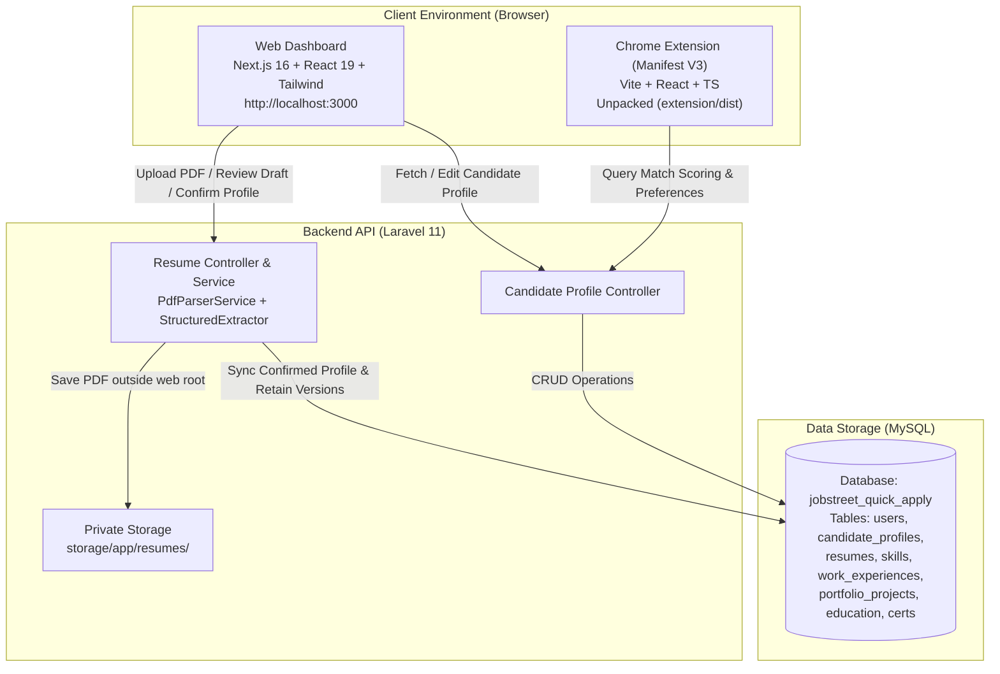
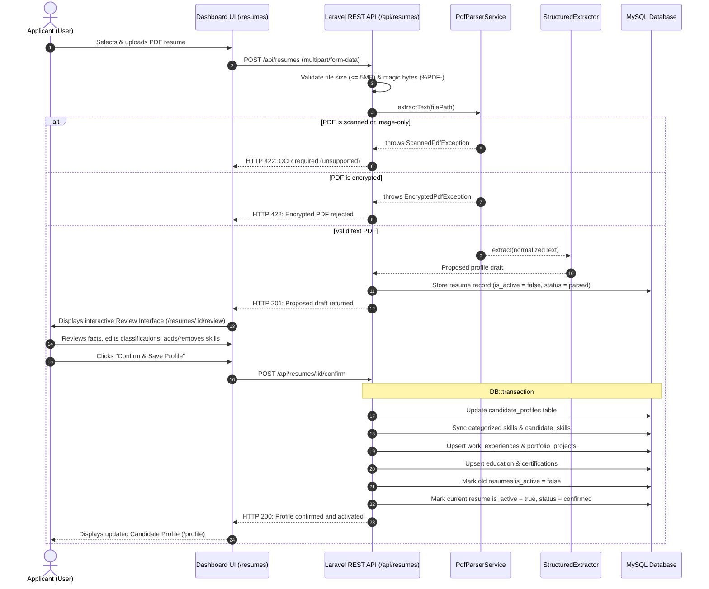
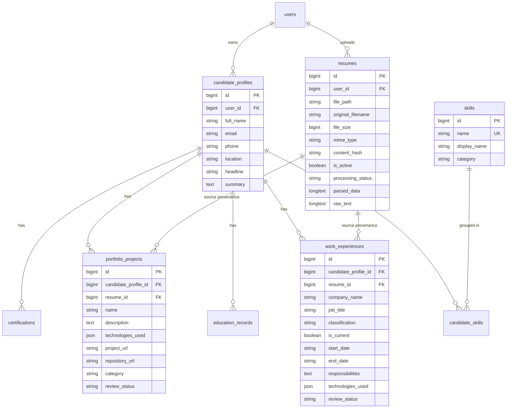

# System Architecture & Application Boundaries

This document defines the architectural boundaries, communication models, security practices, and network topology for the **JobStreet Quick Apply Automation** system.

---

## 1. High-Level Architecture Overview

---

## 2. Resume Ingestion & Review Workflow (Phase 2)

---

## 3. Candidate Profile Data Model (Normalized Schema)

---

## 4. Key Security & Privacy Safeguards

1. **Storage Isolation:** Uploaded resumes are placed in `storage/app/resumes/{user_id}/{sha256}.pdf` outside the public web root. Direct HTTP access to raw files is blocked.
2. **Strict Validation:** File extensions, MIME types, and binary file signatures (`%PDF-`) are checked on every upload.
3. **No External AI Leakage:** Parsing is performed completely locally using deterministic PHP lexicons and regular expressions. No candidate resumes or personal data are transmitted to external AI APIs.
4. **Application History Preservation:** Replacing an active resume does not delete prior resume records. Historical resumes retain their processing status and provenance foreign keys.
5. **Multi-Record Atomicity:** The confirmation action wraps profile updates, skill syncing, experience persistence, and resume status toggling in a `DB::transaction`. If any operation fails, the transaction rolls back cleanly without data corruption.
